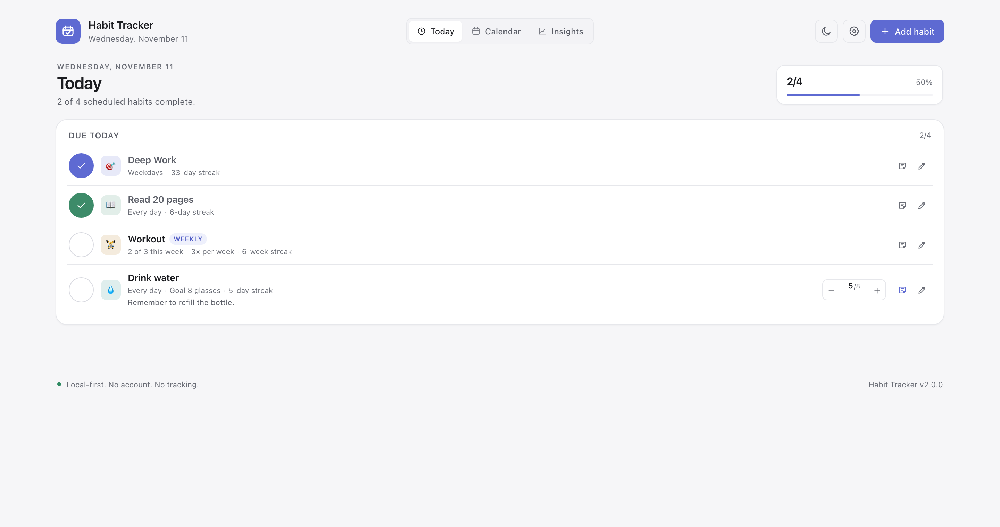
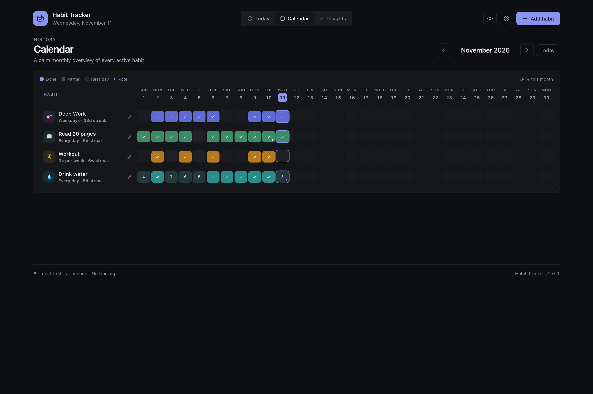
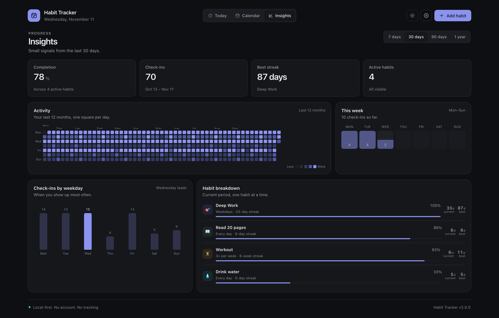

# HabiStride

A local-first habit and routine tracker with flexible schedules, notes, counts, monthly history, insights, and calendar reminders. Built with semantic HTML, modern CSS, and vanilla JavaScript — no framework, no build step, no account.



## What it does

- **Flexible habits** — daily, selected weekdays, a weekly target, or every _N_ days.
- **Two goal types** — simple check-offs or a daily count such as 8 glasses of water.
- **Today view** — a focused daily list with quick check-ins and count controls.
- **Monthly calendar** — a dense overview of every active habit, including partial days, notes, and rest days.
- **Insights** — completion rates, a 12-month activity heatmap, weekday patterns, current and best streaks.
- **Notes and rest days** — add context to any day or mark it as intentional rest so it doesn't break a streak.
- **Archive instead of delete** — preserve history while keeping the daily view clean.
- **Calendar reminders** — export an `.ics` file with per-habit reminder times.
- **Backups and data portability** — JSON backup/restore, CSV export, validation on import, restore points, and undo for destructive actions.
- **Local-first by default** — everything is stored in `localStorage`; there is no server and no tracking.
- **Installable PWA** — offline support, app icons, and installability on supported browsers.
- **Accessible** — keyboard-first controls, semantic tables, ARIA labelling, reduced-motion support, and a Lighthouse accessibility score of 100.





## Quick start

The app is fully static and uses native ES modules. Serve the repository over HTTP rather than opening `index.html` directly, because browsers block module imports from `file://`.

```bash
# Node 20+
npm start
```

Then open <http://localhost:4173>.

There are no runtime dependencies to install. `npm start` runs a tiny zero-dependency static server from `scripts/serve.js`.

On a fresh state, <http://localhost:4173/?demo=1> loads the demo habits without opening onboarding. Optional `theme=light|dark` and `view=today|calendar|insights` parameters make it easy to deep-link a demo or take documentation screenshots.

To reset your local data, use **Settings → Clear data** inside the app.

## Data model

Each habit is stored with the following shape:

```json
{
  "id": "habit-…",
  "name": "Deep Work",
  "emoji": "🎯",
  "color": "#5E6AD2",
  "createdAt": "2026-01-01",
  "archivedAt": null,
  "schedule": {
    "type": "weekdays",
    "weekdays": [0, 1, 2, 3, 4],
    "timesPerWeek": 5,
    "intervalDays": 1
  },
  "goal": { "type": "binary", "target": 1, "unit": "" },
  "reminder": { "enabled": true, "time": "09:00" },
  "logs": { "2026-11-11": true },
  "notes": { "2026-11-11": "A good session." },
  "skips": { "2026-11-10": true }
}
```

`logs` values are `true` for check-off habits and positive numbers for count goals. Weekdays use Monday = `0`. Weekday schedules and weekly targets are schedule-aware: non-scheduled days do not break streaks, and a missed day is only counted when it was actually due.

Backups use `schemaVersion: 2`. Files from the earlier `schemaVersion: 1` format are accepted and migrated on import.

## Project structure

```text
index.html                  App shell and dialogs
style.css                   Design tokens, layout, responsive rules
src/
  main.js                   Boot + service worker registration
  app.js                    Application controller and event wiring
  constants.js              Configuration, templates, colours
  dates.js                  Calendar-date utilities and Intl formatting
  schedule.js               Schedules, due days, streaks
  stats.js                  Completion rates, heatmaps, summaries
  schema.js                 Validation, migration, serialization
  storage.js                localStorage, snapshots, persistence
  store.js                  State mutations and app settings
  backup.js                 JSON/CSV exports
  ics.js                    Calendar reminder (.ics) generation
  demo.js                   English demo habits
  toast.js                  Accessible toast notifications
  dialogs/                  Confirm, habit, day, settings, onboarding
  views/                    Today, Calendar, Insights
sw.js                       Offline app-shell cache
manifest.webmanifest        PWA metadata
icons/                      Generated app icons
tests/                      Node test-runner unit tests
scripts/                    Static server and icon generator
```

## Development

```bash
npm test          # 28 unit tests, no test dependencies
npm run icons     # regenerate PWA icons
```

The test suite covers date handling, schedules, streak edge cases, completion calculations, schema validation and v1 migration, JSON backup parsing, storage/store mutations, and `.ics` output.

## Privacy

No data leaves your browser. There is no analytics, no remote storage, no account, and no third-party fonts. JSON and CSV files are generated locally; `.ics` files are downloaded for your calendar app.

## Deployment

The included `Deploy to GitHub Pages` workflow publishes the repository as a static site. Enable **Settings → Pages → Build and deployment → GitHub Actions** in the repository settings, then push to `main`.

After deployment, add your Pages URL near the top of this README if you want a public live link. A `?demo=1` suffix on a fresh browser opens the demo directly.

## Roadmap

- Optional encrypted sync for multi-device use
- More reminder delivery options (requires a backend for reliable push notifications)
- Import/export presets for other habit trackers
- Additional locales

## License

MIT — see [LICENSE](LICENSE).
